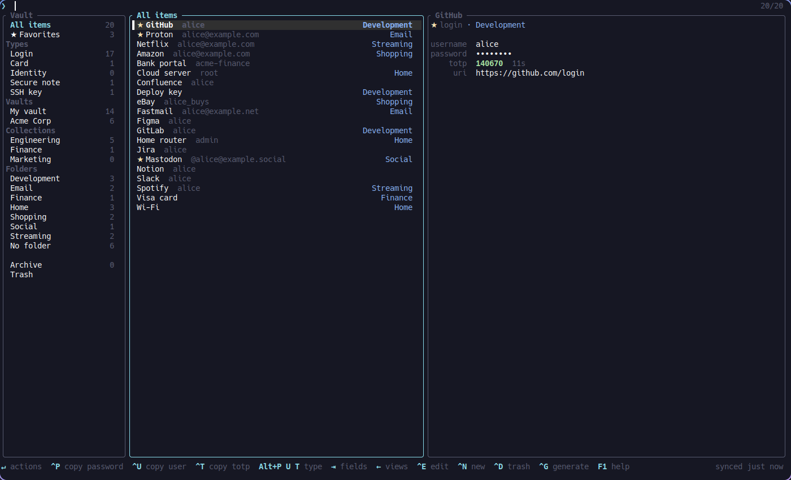
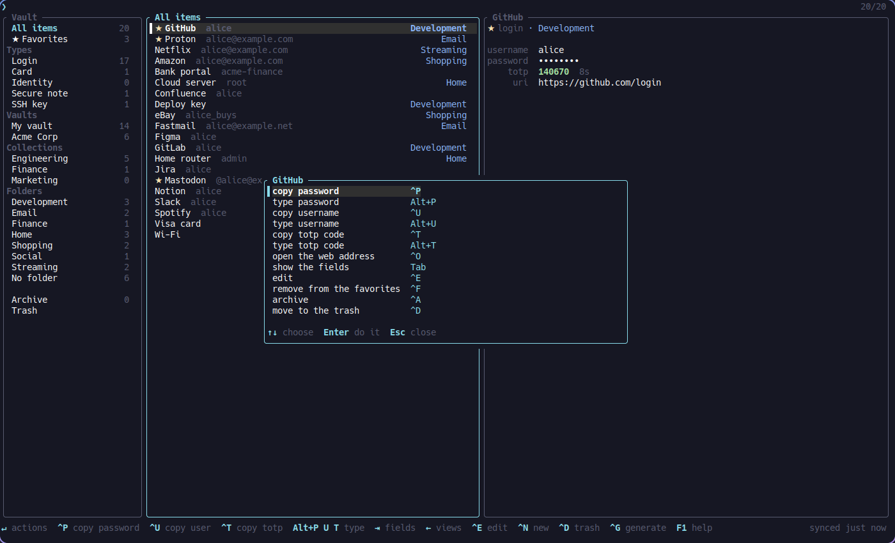
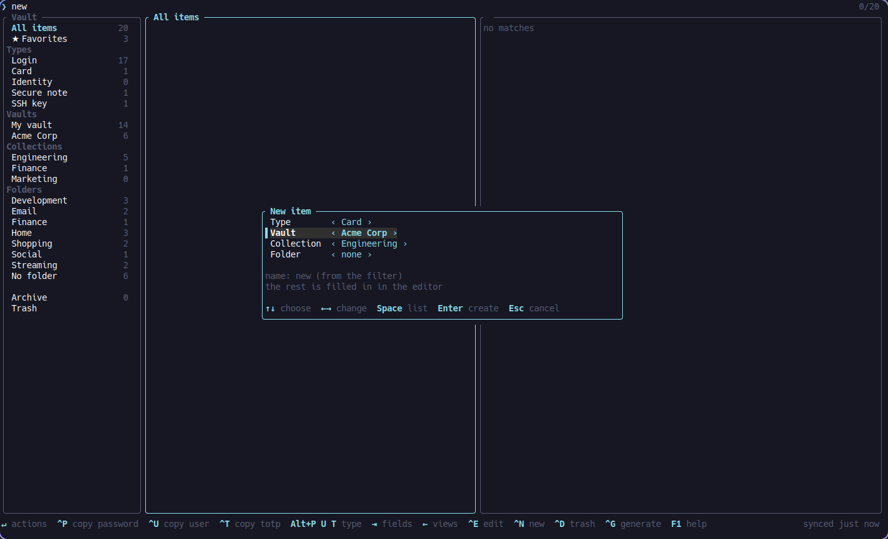
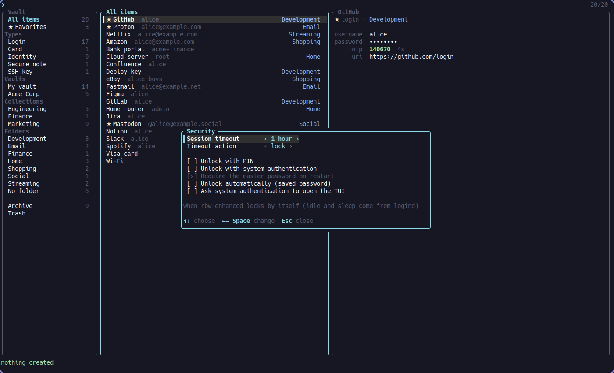

# rbw-enhanced

An unofficial [Bitwarden](https://bitwarden.com/) client for Linux: a fast
terminal UI, full read and write access to the vault, and unlocking like the
official apps. Based on [rbw](https://github.com/doy/rbw) by Jesse Luehrs.

* **Face unlock with [howdy](https://github.com/boltgolt/howdy)**, which
  doesn't work with the official desktop client on current polkit, plus
  fingerprint, PIN or password.
* **Opens by itself at login** if you want: the master password can be kept
  sealed by `systemd-creds` (with the TPM when there is one) or in the
  Secret Service, and the face is asked only to open the TUI.
* **Drop-in replacement for rbw.** Same commands, options and config, and the
  read output (`rbw list --raw`, `rbw get --raw`, ...) is unchanged, so
  scripts and tools like [rofi-rbw](https://github.com/fdw/rofi-rbw) keep
  working.
* **Replaces the official desktop client** for daily use, and **rofi-rbw** if
  you like: the TUI copies and also types credentials into the previous
  window.
* Tested against Vaultwarden 1.37: `tests/vw/e2e.sh` runs 152 checks against
  a throwaway server and verifies every write with an independent decryptor.



## Install

| | |
|---|---|
| Arch Linux | [`rbw-enhanced`](https://aur.archlinux.org/packages/rbw-enhanced) from the AUR (replaces `rbw`) |
| From source | `cargo build --release`, then copy `target/release/rbw` and `rbw-agent` to your `PATH` |

The client and the agent must come from the same build: after upgrading, run
`rbw stop-agent`.

```sh
rbw config set email you@example.com
rbw config set base_url https://vault.example.com   # omit for bitwarden.com
rbw login
rbw tui
```

## The TUI

`rbw tui` opens in about the time of `rbw list` and filters as you type
(fuzzy, with `'exact`, `^prefix`, `suffix$`, `!not`); the entries you use
most come first.

| Keys | |
|---|---|
| `^P` `^U` `^T` | copy password, username, TOTP code (cleared after 30 s) |
| `Alt+P` `Alt+U` `Alt+T` | type them into the previous window and quit, like rofi-rbw |
| `Enter` | menu with every action on the entry; on a field (`Tab`), copy or type it |
| `←` | sidebar: favorites, types, vaults, collections, folders, archive, trash |
| `^N` | new item: login, card, identity, secure note or SSH key, in your vault or an organization's collection |
| `^E` `^D` | edit in your editor, move to the trash |
| `^F` `^A` | favorite, archive |
| `^G` | password generator |
| `^R` `^O` `^S` `^L` | show secrets, open the URL, sync, lock |
| `F2` | security settings, see below |

The mouse works too: a click selects, a double or right click opens the
actions, the wheel scrolls; in a popup a click on the selected row changes
it. Shift+drag still selects text in most terminals.




Typing gives the focus back with the compositor (Hyprland, niri) and types
with `dotool`, `wtype`, `ydotool` or `xdotool`, whichever is installed.

## Unlocking

The same options as the official clients' security settings, from `F2` in
the TUI, `rbw security` or `rbw config set`. They apply without restarting
the agent.

| Official client | rbw-enhanced |
|---|---|
| Session timeout (1 min … 4 h, custom, never) | `lock_timeout 1h` / `90m` / `never` |
| Lock when idle, on sleep | `lock_on_idle true`, `lock_on_sleep true` (from logind) |
| Timeout action: lock / log out | `timeout_action lock` / `forget` |
| Unlock with PIN | `rbw pin set` (argon2id, 5 attempts) |
| Unlock with system authentication | `system_auth true` (polkit: howdy, fprintd, password) |
| Require master password on restart (off) | `rbw remember-password`: the master password is sealed with `systemd-creds` (TPM2 when present) or the Secret Service |
| | `auto_unlock true`: unlock with the saved password without asking |
| | `tui_auth true`: system authentication once per login session to open the TUI |



A common setup: always unlocked after the desktop login, face recognition
only to open the TUI.

```sh
rbw remember-password
rbw config set auto_unlock true
rbw config set tui_auth true
rbw config set lock_timeout never
```

System authentication needs a polkit action and, for howdy, two small system
changes: see [contrib/polkit](contrib/polkit/README.md).

## Writing to the vault

```sh
echo "$PW" | rbw add Example me --uri https://example.com --password-stdin \
    --totp otpauth://... --field pin=1234 --hidden-field token=abc --folder Web
rbw add Card --type card                     # login, note, card, identity, ssh-key
rbw add Wiki --org Acme --collection Engineering
rbw edit Example                             # every field in your editor
echo "$NEW" | rbw edit Example --password-stdin   # old password goes to the history
rbw edit Example --rename Example2 --move-to Archive --favorite true
rbw rm Example                               # to the trash: rbw trash, rbw restore
rbw archive Example                          # rbw unarchive
rbw folder list|add|rename|rm
rbw attachment list|get|add|rm Example
```

Edits fetch the entry from the server, re-encrypt only what changed and send
the rest back untouched: passkeys, attachments, per-item keys and item types
rbw doesn't know about survive. The server's revision check rejects an edit
if the entry changed elsewhere.

## More

* **Persistent login** (`persistent_login true`): when the refresh token is
  rejected (Vaultwarden expires it after 30 days without a sync), the agent
  logs in again with your personal API key instead of asking for the second
  factor. A desktop notification tells you if the login expires anyway.
* **Status for bars:** `rbw status --json` never starts the agent or prompts.
  A [Noctalia](https://github.com/noctalia-dev) bar plugin built on it is in
  [rylos/community-plugins](https://github.com/rylos/community-plugins/tree/rbw/rbw-enhanced).
* **Usage ranking:** `rbw get` and `rbw code` record what you use (ids only);
  the TUI always sorts by it, `sort_by_usage true` also sorts `rbw list`.
* **From upstream pull requests:** rotated refresh tokens are kept (#378),
  batched decryption, so `rbw list` is much faster on big vaults (#359),
  timers survive system sleep (#207), `rbw inject` and `rbw run` (#323).
* **Fixes:** writes failing with 422 on Vaultwarden 1.34+ (#385), edits
  corrupting entries with their own key (#364) or wiping them from an empty
  stdin (#377), cache read while being rewritten, several pinentries for
  commands started together.

For everything inherited from rbw (configuration, profiles, SSH agent, 2FA,
`rbw inject`), see the [upstream README](https://github.com/doy/rbw#readme).

## Credits

rbw is written by [Jesse Luehrs](https://github.com/doy); this fork builds
on his work and keeps its MIT license (see [LICENSE](LICENSE)).
